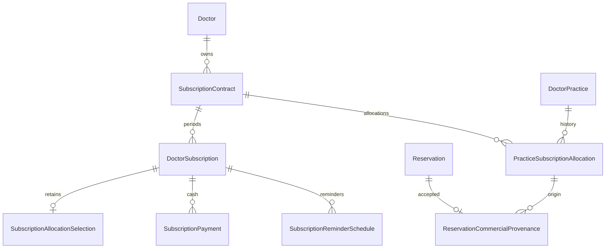

# Commercial subscriptions v1.2 impact and implementation plan

Task: WAS-COMMERCIAL-V1.2-P0. Baseline: `4c2ab2afcc86a3923b593aa4c06a3a6eff4e2ee4`.
Branch: `codex/commercial-subscriptions-v1.2`. Origin fetched 2026-11-05; main unchanged.
PR #36 is merged (2026-11-03T13:27:20Z); no newer PR returned by the connected repository search.
Initial worktree clean. .NET SDK 10.0.401. Restore and baseline build succeeded;
build has zero warnings/errors. Baseline full test run started before code changes;
the valid isolated results are under `artifacts/commercial-v1.2-baseline-isolated*`. See the implementation report for the replaced in-place attempt.

## Authority and explicit supersessions

The supplied approved commercial closure v1.2 supersedes v1.0's single subscription,
registration-selected/approval-started trial, global practice/reception capacities,
Booking Only tiers/maximum, and doctor-wide entitlement/history assumptions.
Approval grants trial eligibility only. Unused trial is doctor initiated and independent
of paid contracts. Booking Only costs 50 EGP per positive purchased monthly seat.
Medical privacy, patient/guardian/consent, Ticket/Encounter separation and practice
ownership remain governed by the existing healthcare source of truth.

## Impact map

* Domain/EF: add stable contract, temporal practice allocation, future retained allocation
  selection, immutable reservation provenance and migration exception records. Keep
  DoctorSubscription as period and preserve all accepted snapshots and ledgers.
* Lifecycle/catalog/registration: remove mandatory subscription and automatic trial;
  independent paid selections; contract-local activation/renewal/change/cancellation;
  lifetime trial uniqueness and 5/2/1/0 reminders; paid 7/3/1/0 reminders.
* Practice/reception: explicit contract for approved creation, atomic allocation and
  transfer/release; distinct assigned active identities per contract; preserve manual
  IsActive and assignment histories. Preapproval draft is bounded to one without trial.
* Authorization: permission guard, practice catalog/branding/configuration, ticket,
  clinical/diagnostic/prescription, reservations/capabilities, finance, reporting and
  archive scopes. Resolve owned practice/resource before commercial evaluation.
* Discovery: filter each eligible allocation/period before grouping/paging/hydration,
  recheck booking at transactional write time, preserve existing projection invalidation.
* Persistence: existing shared DbContext and transactional command behavior remain;
  SQL Server transaction-owned per-doctor application lock serializes capacity writes.
  Filtered current-allocation and contract-period uniqueness plus RowVersion remain
  independent database backstops. SQLite is not proof of SQL locking.

Full baseline symbol inventory: `artifacts/commercial-v1.2-call-sites.txt`. The final tracked audit is [V1.2-CALL-SITE-INVENTORY.csv](V1.2-CALL-SITE-INVENTORY.csv).
Practice context already exists in practice handlers, reservation creation, ticket
authorization, clinical/diagnostic/medication access and reporting filters. Resource
IDs exist in reservation/ticket/encounter routes and linked result handlers. Account,
subscription and global patient routes have no practice context; they must not select
an arbitrary active contract. Original `LatestEndedAsync`/timestamp-only windows are
insufficient evidence of reservation clinical provenance.

## Entity relationships

## Migration and cutover order

1. Document authority; additive domain/schema and migration after foundation, with
   restrictive FKs, named indices, lifetime trial uniqueness and issue reporting.
2. Backfill verified renewal chains only; preserve ambiguous histories as exceptions.
   Allocate existing practices only against proven effective entitlement. Mark verified
   overcapacity without permitting growth; enforce compliant first renewal selections.
3. Implement catalog/lifecycle/trial, allocations/reception and scoped authorization as
   one coherent change. No production migration or behavior toggle during development.
4. Generate migration SQL/snapshot, execute disposable SQL Server rehearsal and test
   UTC boundaries/concurrency/provenance; reconcile counts and retain raw evidence.
5. Deliver API/Angular handoff and release runbook. Production cutover remains gated
   on backup, reconciliation, rollback rehearsal and security/migration review.

No automatic charge/refund, clinical policy change, frontend, merge or deployment is
part of this implementation.
